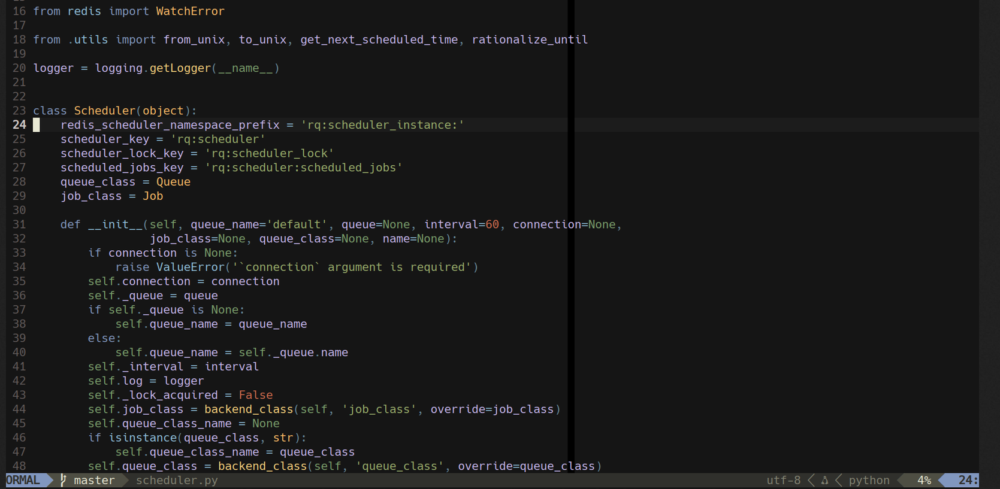

# jellybeans-lua.nvim

A modern Lua port of the classic [jellybeans.vim](https://github.com/nanotech/jellybeans.vim) color scheme for Neovim.



## Features

- 🌙 Full True Color support (`termguicolors`)
- 🌿 Built-in support for Treesitter syntax highlighting and LSP diagnostics
- ⚙️ Flexible configuration via `setup()` (transparent background, italics, overrides)
- 🚀 Compatible with Neovim 0.12+ native package manager (`vim.pack`) and modern managers like `lazy.nvim`

## Installation

### Using Neovim's native package manager (Neovim 0.12+)

Neovim 0.12+ includes a built-in package manager. Add the following to your `init.lua`:

```lua
vim.opt.termguicolors = true

vim.pack.add({
  "https://github.com/mandalay-rp/jellybeans-lua.nvim",
})

require("jellybeans").setup({
  -- Optional: customize the theme
  transparent = false,
  italic_comments = true,
})

vim.cmd.colorscheme("jellybeans")
```

### Using lazy.nvim

```lua
{
  "mandalay-rp/jellybeans-lua.nvim",
  priority = 1000, -- Load before other plugins
  config = function()
    require("jellybeans").setup({
      transparent = false,       -- Enable transparent background
      italic_comments = true,    -- Enable italics for comments
      overrides = {},            -- Custom highlight overrides
    })
    vim.cmd.colorscheme("jellybeans")
  end,
}
```

## Configuration

You can pass a configuration table to the `setup()` function:

```lua
require("jellybeans").setup({
  transparent = false,
  italic_comments = true,
  overrides = {
    -- Override specific highlight groups
    Normal = { bg = "#101010" },
    Comment = { fg = "#777777", italic = true },
  }
})
```

## License

MIT
